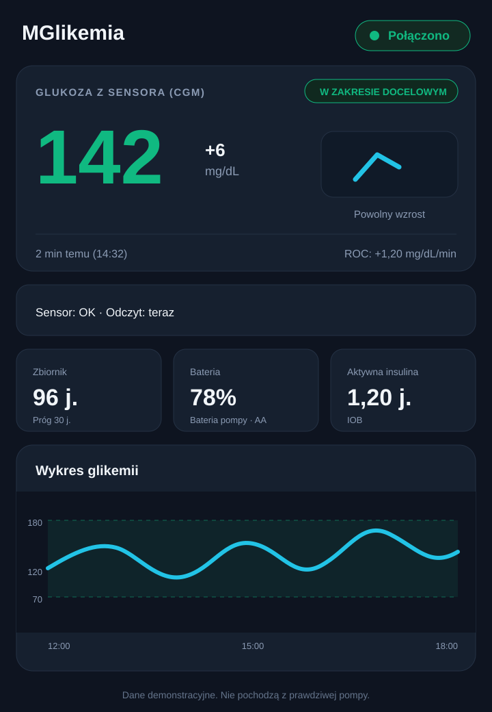
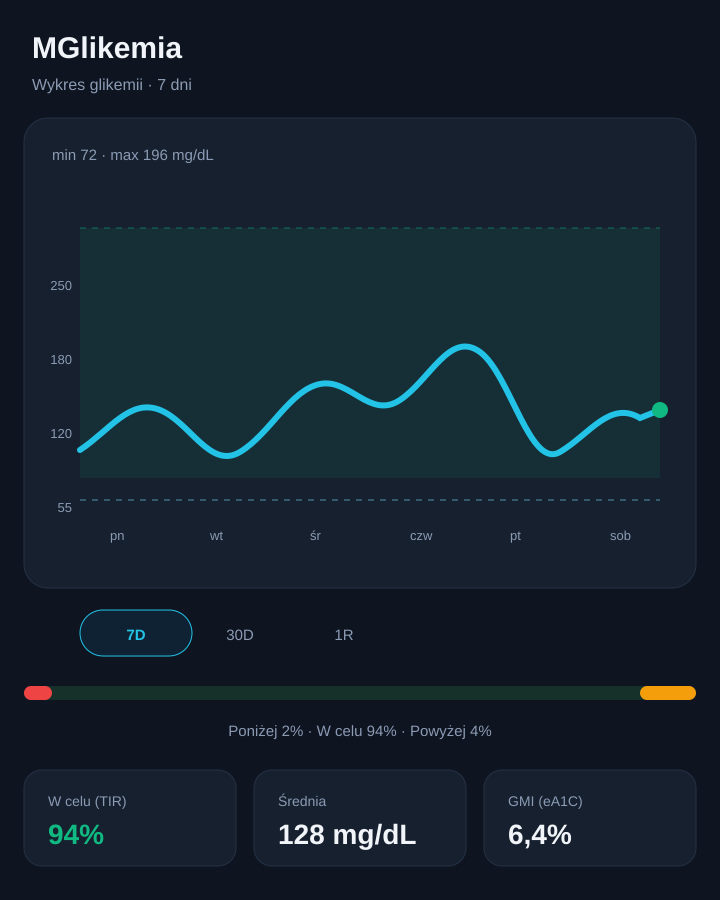

# MGlikemia / MGlycemia

Niezależna aplikacja na Androida do podglądu glikemii z pomp Medtronic MiniMed
780G, 770G i 680G. Telefon jest urządzeniem peryferyjnym BLE, pompa łączy się do
niego i wysyła dane, które aplikacja odczytuje i zapisuje lokalnie.

Aplikacja jest **tylko do odczytu**. Nie wysyła do pompy żadnych poleceń i nie
zmienia jej ustawień. Nie jest wyrobem medycznym.

Nazwa: **MGlikemia** po polsku, **MGlycemia** w pozostałych językach.

## Co potrafi

- aktualny cukier z sensora, trend i tempo zmian
- IOB, aktualna baza (także SmartGuard), bateria, poziom zbiornika
- historia w lokalnej bazie SQLite, wykresy od godziny do roku
- TIR, średnia, GMI, pasmo min/max
- progi alertów glikemii
- eksport i import CSV (backup i przenoszenie danych między telefonami)
- automatyczne aktualizacje z wydań na GitHubie
- interfejs po polsku, angielsku, niemiecku i chińsku

## Zrzuty ekranu

Grafiki pokazują układ aplikacji na danych demonstracyjnych. Nie zawierają danych żadnego użytkownika.





## Wymagania

- Android 7.0 lub nowszy
- Bluetooth LE
- pompa MiniMed 780G, 770G albo 680G

## Pobieranie

https://mgsupport.pl/aplikacja/MGlikemia

## Budowanie

Projekt używa Gradle 9 i wymaga JDK 21. Na Windowsie najprościej wskazać JBR z
Android Studio:

```bash
export JAVA_HOME="/c/Program Files/Android/Android Studio/jbr"
"$JAVA_HOME/bin/java.exe" -Dorg.gradle.appname=gradlew \
  -classpath gradle/wrapper/gradle-wrapper.jar \
  org.gradle.wrapper.GradleWrapperMain :app:assembleDebug --no-daemon
```

APK trafia do `app/build/outputs/apk/debug/app-debug.apk`.

JavaSake jest dołączony do repozytorium jako zwykły katalog (nie submoduł), więc
build nie wymaga dostępu do zewnętrznych repozytoriów.

## Wydawanie nowej wersji

```bash
tools/release.sh 1.0-beta14 "Co się zmieniło"
```

Szczegóły: [docs/RELEASE.md](docs/RELEASE.md).

## Dokumentacja

- [Architektura](docs/ARCHITECTURE.md): komponenty, przepływ danych, baza, CSV
- [Parowanie i diagnostyka BLE](docs/BLE-PAIRING.md): protokół, błędy, znane problemy
- [Wydawanie wersji](docs/RELEASE.md): skrypt, publikacja, GitHub Releases
- [Prywatność](docs/PRIVACY.md): jakie dane zostają na telefonie
- [Historia zmian](CHANGELOG.md)

## Identyfikacja

- `applicationId`: `pl.mgsupport.mglycemia`
- kod: `pl.mgsupport.mglycemia` oraz `pl.mgsupport.mglycemia.core`
- repozytorium: https://github.com/MichaelGrycz/MiniMGSupportMed-WeAreNotWaiting

## Licencja

GNU GPL 3.0. Informacja o projektach, z których kod pochodzi, jest w pliku
[NOTICE](NOTICE). MiniMed jest znakiem towarowym Medtronic; projekt nie jest
powiązany z Medtronic.
